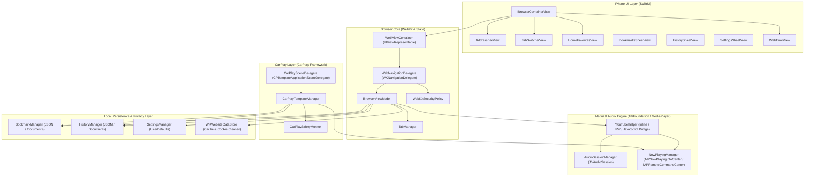
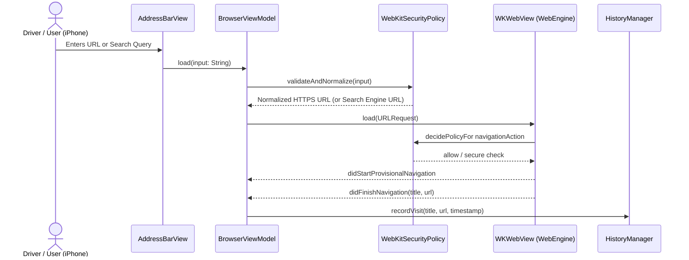
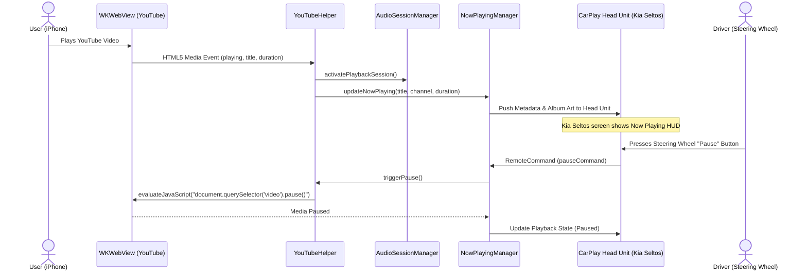
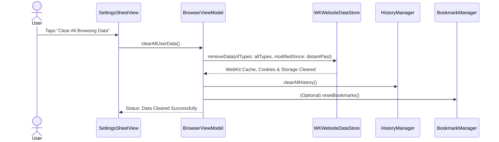

# Deliverable 2: Technical Architecture

**Project:** Private CarPlay Browser for Kia Seltos (`SeltosBrowser`)  
**Platform:** iOS 16.0+, Apple CarPlay (CPTemplateApplicationScene)  
**Language:** Swift 5.9+ / SwiftUI / WebKit  

---

## 1. System Architecture Overview

The system is engineered with strict modular separation to guarantee privacy, platform compliance, maintainability, and clean decoupling between the mobile browser experience and the in-vehicle CarPlay interface.

---

## 2. Module Responsibilities

### 2.1 iPhone Browser Layer
- **`BrowserContainerView`:** Primary container coordinating the address bar, navigation controls (Back, Forward, Refresh, Stop), tab switcher, and bottom toolbar.
- **`AddressBarView`:** Intelligent URL and search query field supporting auto-formatting, HTTPS indicator, domain pill, and quick clear.
- **`TabSwitcherView` & `TabManager`:** Multi-tab session manager allowing users to add, switch, and close isolated browsing tabs.
- **`HomeFavoritesView`:** Quick-access dashboard showing pinned favorites (YouTube, Google, Wikipedia, DuckDuckGo, GitHub) with instant one-tap launching.
- **`WebErrorView`:** User-friendly error messaging for SSL/TLS failures, connectivity drops, and domain resolution issues.

### 2.2 WebKit Engine & Security Layer
- **`WebViewContainer`:** `UIViewRepresentable` wrapping `WKWebView` with custom configuration:
  - `allowsInlineMediaPlayback = true` (enables YouTube HTML5 playback without forced fullscreen).
  - `allowsPictureInPictureMediaPlayback = true` (enables system PiP).
  - `mediaTypesRequiringUserActionForPlayback = []` (allows smooth video/audio playback).
- **`WebNavigationDelegate`:** Monitors web page progression, redirects, SSL certificate challenges, and loading status.
- **`WebKitSecurityPolicy`:** Enforces strict HTTPS transitions, flags mixed content, and rejects unencrypted connections.
- **`WKWebsiteDataStore`:** Manages sandboxed cookies, caches, local storage, and provides one-tap full privacy data wiping.

### 2.3 Media & System Remote Layer
- **`AudioSessionManager`:** Configures `AVAudioSession` category to `.playback` with `.moviePlayback` mode to guarantee uninterrupted audio streaming when the iPhone screen locks or when connected to the vehicle head unit.
- **`NowPlayingManager`:** Synchronizes currently playing web/video media metadata (title, site, playback rate, elapsed time, duration) with `MPNowPlayingInfoCenter`.
- **`MPRemoteCommandCenter` Integration:** Binds Play, Pause, Toggle, Next Track, and Previous Track commands to physical steering wheel controls and Kia Seltos head unit buttons.
- **`YouTubeHelper`:** Specialized helper coordinating YouTube mobile web interactions, handling embedded video state notifications, and preparing audio streams.

### 2.4 CarPlay Interface Layer
- **`CarPlaySceneDelegate`:** Conforms to `CPTemplateApplicationSceneDelegate`. Receives connection from the Kia Seltos CarPlay session (`CPInterfaceController`).
- **`CarPlayTemplateManager`:** Builds and manages the template hierarchy:
  - **Favorites & Bookmarks Template (`CPListTemplate`):** Displays user's saved websites and YouTube channels for one-touch loading.
  - **Recent History Template (`CPListTemplate`):** Displays recently visited sites.
  - **Now Playing Template (`CPNowPlayingTemplate`):** Native CarPlay audio player HUD with artwork and playback controls.
  - **Vehicle Parked / Driving Safety Warning (`CPInformationTemplate`):** Alerts the driver if interactive tasks are attempted while vehicle is in motion.
- **`CarPlaySafetyMonitor`:** Integrates with iOS speed/location heuristics and CarPlay connection state to enforce driving safety standards.

---

## 3. Detailed Data Flows

### 3.1 Web Navigation & Security Verification Flow

### 3.2 YouTube Media Playback & CarPlay Synchronization Flow

### 3.3 Privacy Data Cleansing Flow

---

## 4. Security & Privacy Blueprint

1. **Zero External Telemetry:** The app contains no third-party tracking SDKs (no Firebase, no Google Analytics, no Facebook SDK).
2. **Local-Only Storage:** Bookmarks and browsing history are stored exclusively inside the application sandbox (`Application Support` / `Documents`) in encrypted local files.
3. **Strict HTTPS Default:** Plain HTTP URLs are automatically upgraded or presented with a clear security warning.
4. **Sandboxed Web Storage:** Uses `WKWebsiteDataStore.default()` with explicit granular deletion functions for:
   - Cookies
   - Disk Cache & Memory Cache
   - IndexedDB & WebSQL Databases
   - Local Storage & Session Storage
5. **Driver Safety Adherence:** All CarPlay templates conform strictly to Apple's CarPlay human interface guidelines (HIT), utilizing high-contrast typography, large touch targets, and zero text input while driving.
