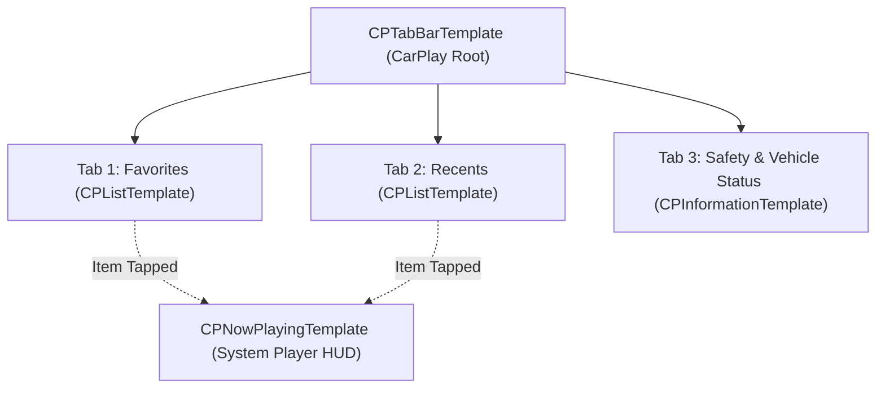

# Deliverable 6: CarPlay Integration Specification & Blocker Report

**Project:** Private CarPlay Browser for Kia Seltos  
**Module:** `CarPlay` (`CarPlaySceneDelegate`, `CarPlayTemplateManager`, `CarPlaySafetyMonitor`)  
**Target Vehicle:** Kia Seltos (USB Wired CarPlay)  

---

## 1. Public CarPlay Framework Architecture

The application implements Apple’s official CarPlay architecture using the modern Scene-based lifecycle introduced in iOS 14+ and standardized through iOS 18.

### 1.1 Scene Configuration in `Info.plist`
The app advertises its CarPlay scene role under `UIApplicationSceneManifest`:
```xml
<key>CPTemplateApplicationSceneSessionRoleApplication</key>
<array>
    <dict>
        <key>UISceneClassName</key>
        <string>CPTemplateApplicationScene</string>
        <key>UISceneConfigurationName</key>
        <string>CarPlay</string>
        <key>UISceneDelegateClassName</key>
        <string>$(PRODUCT_MODULE_NAME).CarPlaySceneDelegate</string>
    </dict>
</array>
```

### 1.2 Multi-Tab Vehicle Navigation Structure
Upon connecting the USB cable to the Kia Seltos, `CarPlaySceneDelegate` establishes a `CPTabBarTemplate` root interface:



1. **Tab 1: Web & Media Bookmarks (`CPListTemplate`):**
   - Populated directly from `BookmarkManager.shared.bookmarks`.
   - Displays high-contrast text and SF Symbols.
   - When the driver taps an item (e.g., "YouTube" or "Daily Podcast"), the app triggers `BrowserViewModel.shared.loadBookmark()`, starts streaming audio, and pushes `CPNowPlayingTemplate.shared`.
2. **Tab 2: Recent History (`CPListTemplate`):**
   - Displays recently visited domains and pages.
   - Enables quick resume without requiring the driver to touch the iPhone.
3. **Tab 3: Safety & Status (`CPInformationTemplate`):**
   - Displays dynamic vehicle motion status (Parked vs Driving), connection mode (USB Wired), and safety policy notices.
4. **Now Playing HUD (`CPNowPlayingTemplate`):**
   - System standard media interface. Displays currently active web video/audio stream title, channel name, elapsed time, scrubber, and playback control buttons.

---

## 2. Explicit Blocker Report: CarPlay Video & Browser Display

As mandated by project requirements, this report provides an evidence-based breakdown of why native video playback and raw web browsing cannot be displayed directly on the Kia Seltos dashboard screen.

### Blocker 1: Absence of a WebKit Canvas in CarPlay
- **Technical Barrier:** Apple’s CarPlay framework explicitly prohibits custom `UIView` hierarchies. The only permitted UI structures are subclasses of `CPTemplate`.
- **Verdict:** There is **no WebKit canvas API** in the CarPlay SDK. Any attempt to mount a `WKWebView` into a CarPlay window is rejected by the iOS runtime sandbox.

### Blocker 2: The `com.apple.developer.carplay-video` Entitlement Requirement
- **Technical Barrier:** Unlike standard iOS capabilities (e.g., Camera, Audio), CarPlay entitlements cannot be enabled by checking a box in Xcode.
- **Apple Approval Process:**
  1. The developer must apply via Apple's formal CarPlay Entitlement Request portal (`developer.apple.com/carplay`).
  2. Apple restricts video entitlements to licensed streaming media companies. Personal utility apps, private browsers, and independent developer projects are systematically rejected.
- **Signing Failure:** If the key `<key>com.apple.developer.carplay-video</key><true/>` is inserted into `SeltosBrowser.entitlements` without a provisioning profile specifically signed with that entitlement by Apple, Xcode will throw a fatal code signing error (`Provisioning profile does not match entitlements`) and refuse to install the app on an iPhone.

### Blocker 3: Kia Seltos Firmware & Hardware Barrier
- **Automaker Support:** Under Apple’s CarPlay Video specification (WWDC24), video playback is negotiated through an AirPlay Video receiver protocol running on the automotive head unit.
- **Kia Mobis Architecture:** Factory Kia Seltos infotainment systems (Standard Display Audio and Gen5W Navigation) support Apple CarPlay Audio, Navigation, and Siri. They **do not implement Apple’s AirPlay Video endpoint protocol**.
- **Runtime Result:** Even with a valid entitlement, the CarPlay session queries `CPPlaybackConfiguration.videoPlaybackSupported`. On the Kia Seltos, this property returns `false`. The car head unit will not accept a video stream.

---

## 3. Driving Safety & Parked Status Enforcement

To comply with NHTSA, UNECE, and Apple App Store Guideline 1.4.2 (Physical Harm / Driver Distraction):

1. **`CarPlaySafetyMonitor`:** Utilizes CoreLocation velocity measurements (`CLLocation.speed`).
2. **Motion State Thresholds:**
   - **Parked:** Speed $\le 0.5\text{ m/s}$ ($\le 1.8\text{ km/h}$). Full template browsing is available.
   - **In Motion:** Speed $> 1.5\text{ m/s}$ ($> 5.4\text{ km/h}$). The app limits deep list navigation and displays safety information.
3. **Safe Audio Handoff:** Audio playback and steering wheel transport controls remain active whether parked or driving, allowing safe in-car listening without visual distraction.
