# Windows Sideloading Guide: Deploying SeltosBrowser to iPhone

**Project:** Private CarPlay Browser for Kia Seltos  
**Author:** Senior Mobile Infrastructure & Security Specialist  
**Development PC:** Windows 10 / 11  
**Target Device:** iPhone (iOS 16, 17, or 18)  
**Vehicle:** Kia Seltos (USB Wired Apple CarPlay)  

---

## 1. Overview: Sideloading from Windows Without a Mac

Because your primary workstation runs Windows, this guide provides a 100% working path to compile, sign, and install `SeltosBrowser` onto your iPhone using free cloud CI/CD and standard Windows sideloading tools.

```mermaid
flowchart LR
    A["Windows PC<br>(Local Git Repo)"] -->|"git push"| B["GitHub Repository<br>(Private)"]
    B -->|"Triggers"| C["GitHub Actions<br>(macOS Runner)"]
    C -->|"Compiles & Packages"| D["SeltosBrowser.ipa<br>(Download Artifact)"]
    D -->|"Download to Windows"| E["Sideloadly / AltStore<br>(Windows Utility)"]
    E -->|"Signs with Apple ID & Deploys over USB"| F["iPhone<br>(Installed App)"]
    F -->|"Plug into Car USB"| G["Kia Seltos<br>(Apple CarPlay Active)"]
```



---

## 2. Step 1: Push Repository to GitHub

From your Windows command line (PowerShell or Terminal in Visual Studio Code) inside `c:\Moved_From_E\TEST\Apple CarPlay`:

1. Create a new, **private** repository on [GitHub](https://github.com/new) named `SeltosBrowser`.
2. Link your local repository to GitHub and push:
   ```powershell
   git remote add origin https://github.com/<your-username>/SeltosBrowser.git
   git branch -M master
   git push -u origin master
   ```

---

## 3. Step 2: Download `SeltosBrowser.ipa` from GitHub Actions

1. Open your repository on GitHub in your web browser.
2. Click on the **Actions** tab at the top.
3. You will see the **iOS Build & Package Pipeline** running automatically.
4. The cloud Apple Silicon runner (`macos-14`) will:
   - Run `xcodegen generate`
   - Execute all unit tests in `SeltosBrowserTests`
   - Compile the release binary
   - Package the app into `SeltosBrowser.ipa`
5. Once complete (takes ~2 minutes), click on the workflow run.
6. Under **Artifacts** at the bottom of the summary page, click **`SeltosBrowser-IPA`** to download `SeltosBrowser.ipa` directly to your Windows PC.

---

## 4. Step 3: Install onto iPhone Using Sideloadly (Recommended)

**Sideloadly** is a reputable, free Windows utility that signs `.ipa` packages using your personal Apple ID and deploys them to your connected iPhone.

### 4.1 Prerequisites on Windows
1. **iTunes for Windows (Non-Microsoft Store version):** Ensure native Apple Mobile Device Support drivers are present. If you have the Microsoft Store version of iTunes, install the direct standalone iTunes from [Apple Support](https://support.apple.com/downloads/itunes).
2. **Download Sideloadly:** Download and install Sideloadly for Windows from [sideloadly.io](https://sideloadly.io).

### 4.2 Sideloading Execution Steps
1. Connect your iPhone to your Windows PC via your USB-to-Lightning or USB-C cable.
2. Unlock your iPhone screen and tap **Trust This Computer** when prompted.
3. Open **Sideloadly** on Windows. It will display your connected iPhone name in the *Device* dropdown.
4. Drag and drop the downloaded **`SeltosBrowser.ipa`** into the large IPA icon box in Sideloadly.
5. In the **Apple ID** field, enter your personal Apple ID email address.
6. Click **Start**.
7. If prompted, enter your Apple ID password (this is used solely by Apple’s signing server to generate a 7-day personal development certificate).
8. Sideloadly will extract, re-sign, and transfer `SeltosBrowser` directly onto your iPhone home screen.

---

## 5. Step 4: First-Time iOS Device Verification

Before the app can open on your iPhone, iOS requires two quick security authorizations:

### 5.1 Enable iOS Developer Mode (iOS 16+)
1. On your iPhone, open **Settings** > **Privacy & Security**.
2. Scroll to the very bottom and tap **Developer Mode**.
3. Toggle the switch **ON** and tap **Restart**.
4. After your iPhone boots up, unlock it and tap **Turn On** in the system prompt.

### 5.2 Trust the Personal Certificate
1. On your iPhone, open **Settings** > **General** > **VPN & Device Management**.
2. Under *Developer App*, tap your Apple ID email.
3. Tap **Trust "[Your Apple ID]"** and confirm **Trust**.

Now tap **Seltos Browser** on your iPhone. The browser will open instantly!

---

## 6. Step 5: Plug into Kia Seltos & Test CarPlay

1. Take your iPhone and an MFi-certified data cable to your **Kia Seltos**.
2. Start the vehicle engine / accessories.
3. Connect the cable to the **front center console multimedia USB port** (next to the 12V socket).
4. When your iPhone prompts *"Allow Seltos Browser with CarPlay while locked?"*, select **Allow**.
5. On the Kia Seltos touchscreen, tap the **Seltos Browser** icon.
6. Tap **Favorites** > **YouTube** from your car screen or phone.
7. Start any video. Enjoy clean, high-fidelity car audio, steering-wheel seek/pause controls, and the native CarPlay Now Playing HUD!
